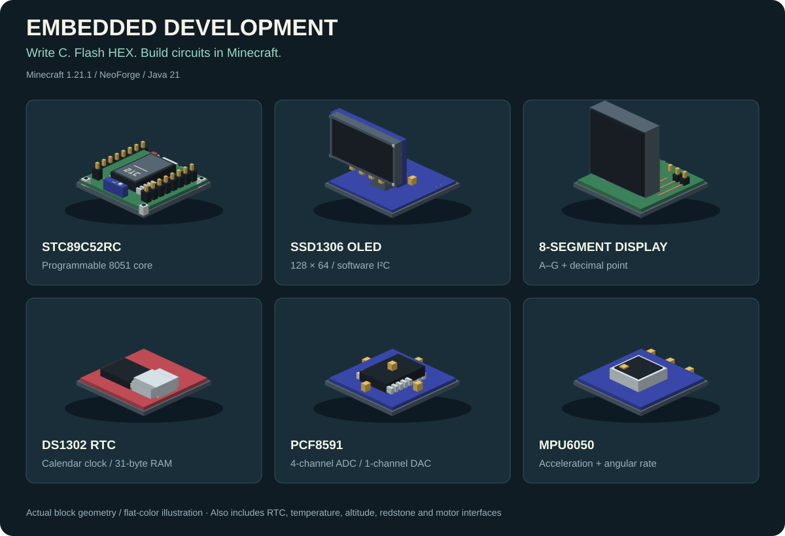
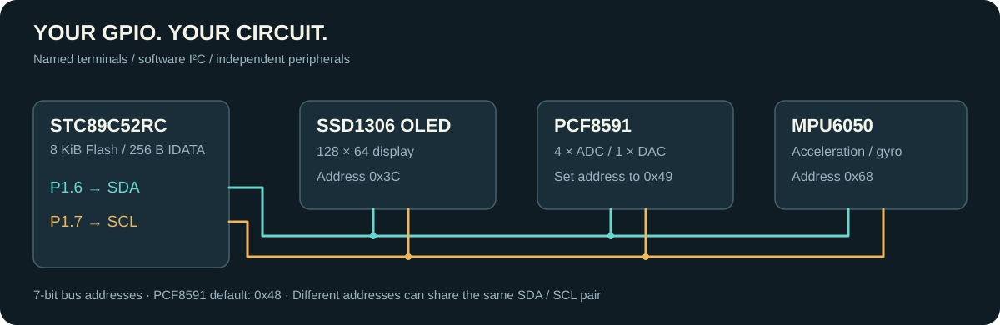

<div align="center">

# Embedded Development · 嵌入式开发

**把 51 单片机搬进 Minecraft，用自己的 C 程序驱动方块世界。**

Minecraft **1.21.1** · NeoForge **21.1.233** · Java **21**

[下载模组](https://github.com/MysteryMan-x/embeddeddev-1.21.1/releases/latest) · [快速开始](#快速开始) · [模块一览](#模块一览) · [驱动源码](examples/drivers/README.md) · [详细文档](docs/user-guide.md)

</div>



*根据实际方块模型生成的等距渲染示意图，使用简化材质配色。*

从点亮第一盏 LED 开始，到按钮交互、温度采集、OLED 显示，再到红石自动控制：放置开发板，配置 GPIO，拉起线缆，烧录 HEX，让程序在游戏里的 MCU 上运行。

本模组提供 STC89C52RC 的 8051/8052 指令执行核心，可以烧录 Keil C51 等工具生成的 Intel HEX。外设通过普通 GPIO 上的软件 I²C、三线和 1-Wire 协议通信。基础玩法独立可用，机械动力等模组提供可选扩展。

## 可以做什么

| 从这里开始 | 逐步扩展你的电路 |
| --- | --- |
| **编程与调试** | 8 个可选内置 HEX 示例、本地文件选择与拖入烧录；运行、停止、复位、单步，以及 PC、机器码和反汇编查看 |
| **自由连线** | 拿线卷依次点击两个端子；细线缆在世界中可见，接线柱支持转角、延长和分支 |
| **自定义引脚** | 东南西北上下六面，每面 4 组端子；每组可绑定多个 GPIO，按 SDA、SCL、DQ 等标号配对 |
| **交互与显示** | 1–9 键按钮面板、LED、八段数码管和独立 128×64 OLED |
| **测量与控制** | 时钟、温度、模拟量、环境数据、惯性与高度；通过红石接口控制支持红石的设备 |
| **生存制造** | 硅石矿 → 粗硅料 → 硅片，配合覆铜电路板、芯片和晶振组装电路；内置 29 条配方 |

## 游戏内手册

**入门 / 开发 / 模块 / 速查 / 附录**，共 **46 个双语条目**。包含生存配方、接线图、寄存器表、实验步骤和故障排查，支持搜索、书签和代码复制。

附录收录 **11 组通用驱动、40 份完整 C/H 文件**，包含公共依赖与最小主程序。复制按钮复制完整文件；源码也可从 [examples/drivers](examples/drivers) 查看，或下载 [1.13.0 驱动源码包](https://github.com/MysteryMan-x/embeddeddev-1.21.1/releases/download/v1.13.0/embeddeddev-driver-sources-1.13.0.zip)。

## 快速开始

1. 安装 **Minecraft 1.21.1 + NeoForge 21.1.233 + Java 21**，从 [Releases](https://github.com/MysteryMan-x/embeddeddev-1.21.1/releases/latest) 下载模组 JAR，放进实例的 `mods` 文件夹。联机时客户端与服务端都需要安装。
2. 放置 **51 单片机最小系统板**，空手右键打开。在「六面端子」中选择一面与线组，添加 GPIO 引脚并应用。
3. 拿 **绝缘线卷**依次右键开发板端子和模块。多个引脚按标号匹配，也可以在配对窗口手动选择；用接线柱延长，用线钳拆线。
4. 返回「烧录与调试」，从列表选择内置示例，点击「烧录 HEX」，再点击「运行」。悬停示例可查看接线与晶振要求。
5. 自己编程时，使用「本地 HEX」选择文件或拖入文件。用书、纸和红石合成 **手册**，随时查阅模块说明。

### 第一块 OLED：两根信号线

| 开发板 GPIO | 引脚标号 | OLED 端子 |
| --- | --- | --- |
| P1.6 | `SDA` | SDA |
| P1.7 | `SCL` | SCL |

配置好同一组的这两个引脚，用线卷将端子组连接到 OLED，选择 **`i2c_oled_hello.hex`** 并运行。OLED 会显示 `EMBEDDED DEV`、`STC89C52` 和 `HELLO MINECRAFT` 等文字。右键屏幕可放大查看，模块内部提供供电，无需另接电源线。

推荐学习路线：**LED → 按钮 → 自由连线 → 数码管 / OLED → 温度采集 → 多模块共享总线**。

## 模块一览

下表中的 I²C 地址均为 **七位总线地址**，不是 MCU 内存地址。软件 I²C 使用普通 GPIO，不需要专用硬件 I²C 页面。

| 模块 | 接口 / 地址 | 用途 |
| --- | --- | --- |
| 51 单片机最小系统板 | P0.0–P3.7 | 烧录运行、单步调试、六面端子和可替换晶振 |
| 按钮面板 / LED | GPIO | 每块面板 1–9 个可命名按钮，每键单独拉线；LED 显示数字电平 |
| 八段数码管 | A–G、DP | 共阳 / 共阴切换，自定义段码和小数点 |
| 0.96 寸 OLED · SSD1306 | I²C · `0x3C` | 独立 128×64 屏幕和 1024 字节显存 |
| PCF8591 | I²C · `0x48–0x4F` | 四路 ADC 与一路 DAC，把红石强度映射为模拟量 |
| DS1302 | CE、SCLK、IO | BCD 日历时钟、31 字节 RAM 和突发读写 |
| DS18B20 | 1-Wire · DQ | 温度、ROM 寻址、CRC 与 9–12 位分辨率；可读取兼容设备的温度 |
| 环境传感器 | I²C · `0x48` | 红石、天光、方块光和一天进度 |
| MPU6050 | I²C · `0x68 / 0x69` | 三轴原始加速度与角速度，姿态解算由固件完成 |
| ALT-01 高度计 | I²C · `0x76` | 世界高度、相对零点高度与垂直速度 |
| 多通道电机接口 | I²C · `0x60–0x67` | 每块六路，控制紧邻六面的机械动力创造马达；含停机看门狗 |
| 红石接口 | GPIO | 数字信号与 0 / 15 红石电平互转 |
| 接线柱 / 线卷 / 线钳 | 命名端子与可见线缆 | 每段最多 32 格，支持延长、分支和拆线回收 |
| 晶振 / 罗盘 | 开发板插槽 / 方位工具 | 6、11.0592、12、22.1184、24 MHz；罗盘帮助辨认世界方向 |

**共享总线要检查地址冲突：**环境传感器和 PCF8591 默认都是 `0x48`；潜行空手右键 PCF8591 可更换地址。GPIO 先写 1 释放端口后再读取外部输入。



*接线示意：图中的 PCF8591 已改为 0x49；同一对 GPIO 可连接多个不同地址的模块。*

寄存器、单位、端序与最小驱动见 [独立模块与驱动手册](docs/modules-and-drivers.md) 和 [驱动使用说明](examples/drivers/README.md)。

## MCU 规格与边界

| 项目 | 当前实现 |
| --- | --- |
| 程序 Flash | **8 KiB**，代码地址 `0x0000–0x1FFF` |
| 内部数据 RAM | **256 字节 IDATA**，SFR 独立 |
| 外部数据 RAM | **64 KiB XDATA / XRAM**，全部为普通 RAM |
| 指令与调试 | 255 个已定义基础操作码，四组寄存器、位操作、双 DPTR、MOVC / MOVX |
| 定时与中断 | Timer 0 / 1 / 2、标准 IE / IP 两级优先级、Idle / Power-down |
| 晶振 | 默认 11.0592 MHz，可替换；以 12T 机器周期运行 |

STC89C52RC **没有片内 ADC / DAC**；需要模拟量时使用独立 PCF8591。OLED 和其他模块均通过协议访问，**不占用 IDATA、SFR 或 XDATA 的外设映射窗口**。

这是指令与外设协议层面的游戏仿真：世界输入通常按 20 TPS 更新，区块卸载后 MCU 暂停，不模拟真实电气特性。UART 为虚拟控制台。STC 特有的 IAP / EEPROM、看门狗、额外中断和 6T / 1T 加速尚未实现。

Keil C51 固件可用 Intel HEX 烧录；附录驱动实际编译验证使用 SDCC，Keil 声明分支尚未在 Keil 中验证。

## 可选模组集成

- **机械动力 Create：**通过红石接口控制离合器、红石链路等；多通道电机接口可以直接控制紧邻的创造马达。DS18B20 可把锅炉热量等级折算为游戏温度，换算规则见手册。
- **Mekanism：**DS18B20 可从兼容热量接口读取温度。
- **Sable：**为移动结构上的惯性传感器、高度计和线缆提供运动数据与位置变换。

这些都是可选集成，**基础开发板、显示器和传感器不要求安装其他科技模组**。项目未修改第三方模组代码，发布包不捆绑第三方模组或四轴飞行器。

## 文档与源码

- [使用与开发指南](docs/user-guide.md)：完整接线、烧录、生存制造、存档行为、旧版迁移和仿真限制。
- [独立模块与驱动手册](docs/modules-and-drivers.md)：MPU6050、高度计、电机接口的寄存器与开发约定。
- [通用 C/H 驱动](examples/drivers/README.md)：文件依赖、默认引脚、编译方法和最小主程序。
- [固件示例](examples)：8 个内置 HEX 对应的源文件与支持代码。

## 从源码构建

需要 Java 21。Windows 使用 `gradlew.bat`，Linux / macOS 使用 `./gradlew`。

```powershell
.\gradlew.bat build
.\gradlew.bat runClient
```

产物位于 `build/libs/`。需要单独检查时：

```powershell
.\gradlew.bat verifyMcu
.\gradlew.bat verifyHandbook
.\gradlew.bat runGameTestServer

# 安装 SDCC 后，编译并在 MCU 解释器中验证 11 组最小驱动程序
.\tools\build-driver-examples.ps1
.\gradlew.bat verifyDriverExamples
```

1.13.0 发布前已通过本地构建、MCU / 手册检查、11 组真实编译驱动执行检查及 26 项游戏测试。测试与本地实验工具不打入发布 JAR。
